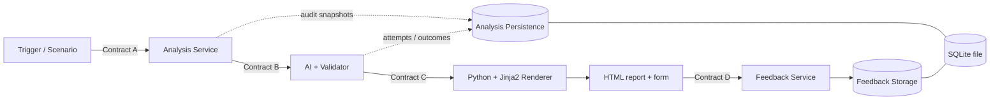

# Database Reliability Advisor

An intentionally lightweight, **mock-first foundation** for an AI-assisted database reliability advisor. Default execution uses `MockAdapter` and `MockAIProvider`; it makes no Gemini call and requires no AI credentials. Fixture values are illustrative, not production telemetry.

## Architecture



Analysis persistence and feedback are separate workstreams/repositories even though SQLite is shared. SQLite is not used to find current evidence for AI. AI returns structured data, normal Python code assembles Contract C, and Jinja2 renders escaped HTML.

## Quick start

Requirements: Docker Compose, `curl`, and Python 3.

```bash
cp .env.example .env
make up
make demo-query
make demo-connection
make smoke
make test
```

The single-port demo entry point is `http://localhost:38000/`. Existing direct development ports remain available: Analysis `:8000`, Orders `:8001`, Prometheus `:9090`, Alertmanager `:9093`, Grafana `:3001`, Loki `:3100`. Set `PUBLIC_BASE_URL` when using a tunnel or port-forward; the gateway itself is the only port that needs to be exposed externally.

## Expose the demo with ngrok

The controlled public-demo helper exposes only the unified gateway, never the individual service ports:

```bash
ngrok config add-authtoken <YOUR_TOKEN>
./scripts/expose-demo.sh
```

The script requires Docker, `curl`, Python 3, and an authenticated ngrok installation. It discovers the generated HTTPS URL, temporarily applies it as `PUBLIC_BASE_URL` to Grafana, Prometheus, and Alertmanager, validates local and public routes, and prints links for the landing page, Advisor, Grafana, Prometheus, Alertmanager, Orders docs, and Loki readiness. It does not edit `.env`, expose ports `8000`, `8001`, `3001`, `9090`, `9093`, or `3100`, or delete data volumes.

Grafana remains anonymous Viewer access: dashboards and curated Loki panels are available, while Explore is intentionally unavailable to anonymous viewers. The gateway continues to block `/orders/dev/*`. This is a temporary demo tunnel, not production access control; do not expose the stack to untrusted public traffic without adding authentication and an appropriate security boundary.

Press Ctrl-C to stop the tunnel. The script stops only the ngrok process it started, restores the local Docker URL configuration, and leaves Docker services running. Use `./scripts/expose-demo.sh --stop-stack-on-exit` only when stopping the local Compose services is explicitly desired.

## Single-port demo access

| Path | Purpose |
| --- | --- |
| `/` | Demo landing page. |
| `/grafana/` | Grafana dashboards and Explore. |
| `/prometheus/` | Prometheus graph and targets. |
| `/alertmanager/` | Alertmanager UI. |
| `/advisor/` | Analysis UI, reports, audit, replay, and feedback. |
| `/advisor/docs` | Analysis API documentation. |
| `/orders/docs` | Orders API documentation. Development workload routes are intentionally blocked at the gateway. |
| `/loki/ready` and `/loki/api/v1/*` | Read-oriented Loki API; Loki has no standalone graphical UI. |

Grafana runs anonymously as a read-only demo surface; the login form and basic admin authentication are disabled. Do not expose this development stack to an untrusted network without adding access control at the tunnel or gateway.

## Grafana / Loki

Open `/grafana/` and select **DB Reliability Advisor — Live Evidence**. To inspect arbitrary logs, open **Explore**, select the provisioned **Loki** datasource, choose a time range containing the workload, and run LogQL. Useful verified selectors are:

```logql
{service="orders-api",source="application-log"}
{service="mongodb",source="diagnostic-log"}
{service="mongodb",source="diagnostic-log"} |= "reliability_demo.orders" | json | msg="Slow query" | attr_appName="orders-api"
{service="orders-api",source="scenario-marker"} | json
{service="orders-api",source="scenario-marker"} | json | scenarioId="<scenario-id>"
```

Alloy ships MongoDB diagnostic logs and Orders API application logs to Loki. Live Query Regression also writes a scenario marker stream with a `scenarioId`. The dashboard uses Loki for all log panels and Prometheus for metric panels; the UI time range must include the actual observation window.

## Prometheus

Open `/prometheus/` for the graph, targets, and direct PromQL verification. The dashboard includes Orders API request rate, p95, error rate, Mongo connection utilization, and exporter health.

## DB Reliability Advisor

Open `/advisor/` for manual analysis and recent reports. Reports are available at `/advisor/analyses/{analysisId}/report`; the API exposes `/advisor/api/v1/analyses`, `/audit`, `/replay`, and `/feedback`. The live Query Regression runner is invoked with `make demo-live-query` and still uses the internal/direct Orders API path; the gateway intentionally does not publish `/orders/dev/*`.

Manual API trigger:

```bash
curl -X POST http://localhost:8000/api/v1/analyses \
  -H 'Content-Type: application/json' \
  -d '{"target":"orders-api","startTime":"2026-09-20T11:00:00Z","endTime":"2026-09-20T11:10:00Z"}'
```

The API returns the analysis ID; open `/analyses/{analysisId}/report` for the HTML report. Contract A intentionally contains only `target`, `startTime`, and `endTime`. In development, the UI also exposes query-regression and connection-pressure fixture buttons; fixture selection stays outside Contract A and enters the same pipeline.

Audit and replay API:

```bash
curl http://localhost:8000/api/v1/analyses
curl http://localhost:8000/api/v1/analyses/AN-.../audit
curl -X POST http://localhost:8000/api/v1/analyses/AN-.../replay
```

The audit API exposes immutable Contract A/B/C snapshots, deterministic findings, lifecycle events, ordered provider attempts, validation outcomes and fallback details. Replay creates a new analysis ID from the stored Contract B snapshot and never calls telemetry adapters. SQLite is an audit/history side path, not the normal evidence source. File-backed startup applies `alembic upgrade head`; the `analysis-data` Compose volume preserves records across restarts. Retention/cleanup is intentionally future work.

The default `AI_PROVIDER=mock` is deterministic and suitable for local tests. To exercise Gemini, set `AI_PROVIDER=gemini`, provide `GEMINI_API_KEY`, and optionally change `GEMINI_MODEL` (default `gemini-3.8-flash`). Gemini supplies interpretation only: trusted values, charts, provenance, and verification queries come from Contract B/application code. Mock verification entries are explicitly labelled illustrative and were not executed.

Reports distinguish status from hypothesis confidence, show supporting versus contradicting evidence, recommend a next investigation with its purpose, and keep limitations prominent. Feedback is submitted from the report form to Contract D and stored separately from analysis evidence.

## Evidence flow and MVP boundary

```text
Orders workload → MongoDB → Prometheus/Loki/Mongo metadata
→ adapters → EvidenceBuilder → DeterministicAnalyzer → Contract B
→ Gemini interpretation → GroundingValidator → TrustedReportData
→ Contract C → report/audit/replay/feedback
```

The MVP proves, when the live path is run, real observability ingestion, bounded evidence/provenance, deterministic facts, grounded interpretation, validation/fallback, and persisted audit/replay/feedback. It does not provide automatic remediation, a definitive root cause when evidence is insufficient, production-scale guarantees, or a live connection-pressure scenario: that scenario remains fixture/mock-based in this repository. Healthy/noise abstention is covered by tests and insufficient-evidence handling, not by a separate live demo workload.

The demos call development-only selectors that build ordinary Contract A requests and enter the same pipeline. Scenario selection is never part of Contract A. Run `make setup` for Python-only development, `make lint` for Ruff, and `docker compose config --quiet` to validate Compose. `make reset` removes named volumes, including local SQLite and Mongo data.

## Future work boundaries

- Real workloads/triggers belong to **DBADV-01**.
- Prometheus/Loki/Mongo analysis belongs to **DBADV-02**; connectivity/visualization does not mean a real analysis adapter exists.
- Advanced grounding, repair/fallback policy and production Gemini behavior belong to **DBADV-03**.
- **DBADV-04** owns server-rendered HTML; **DBADV-05** owns analysis audit; **DBADV-06** owns feedback workflow/storage.

See [docs/WORKSTREAMS.md](docs/WORKSTREAMS.md), [docs/ARCHITECTURE.md](docs/ARCHITECTURE.md), and [docs/CONTRACTS.md](docs/CONTRACTS.md).

## Optional Gemini provider

The Google GenAI SDK is available for deliberate network-backed experiments. Configure `AI_PROVIDER=gemini`, `GEMINI_API_KEY`, and `GEMINI_MODEL`; mock mode remains the default. This foundation does not claim advanced semantic grounding.

## Repository map

```text
contracts/                         Project-level JSON Schemas and examples
services/analysis_service/app/     Pipeline, adapters, AI, storage, Jinja reports
services/orders_api/app/           Instrumented MongoDB demo API
services/scenario_runner/          Mock scenario CLI
infra/                             MongoDB, Prometheus, Alertmanager, Loki, Alloy, Grafana
migrations/                        Alembic lifecycle
tests/                             Contract, unit, integration and smoke tests
scripts/                           Seed, demo and smoke utilities
docs/                              Architecture, contracts, development and ownership
```
